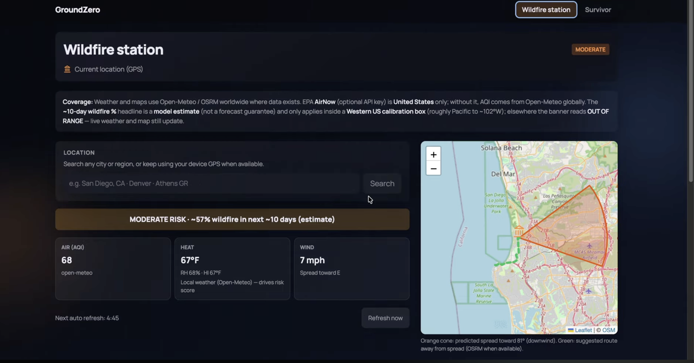
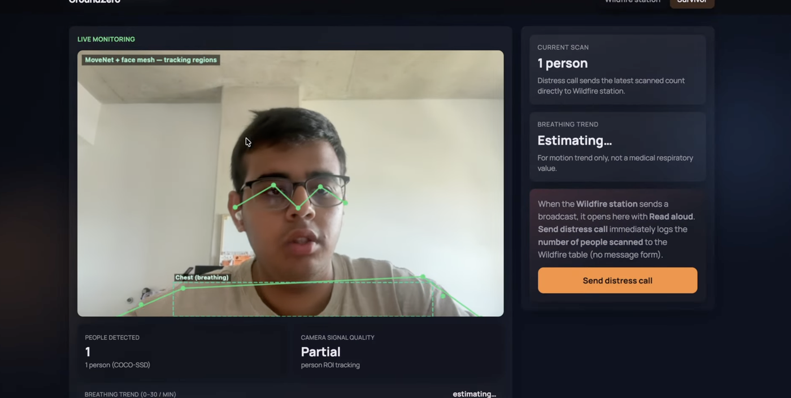
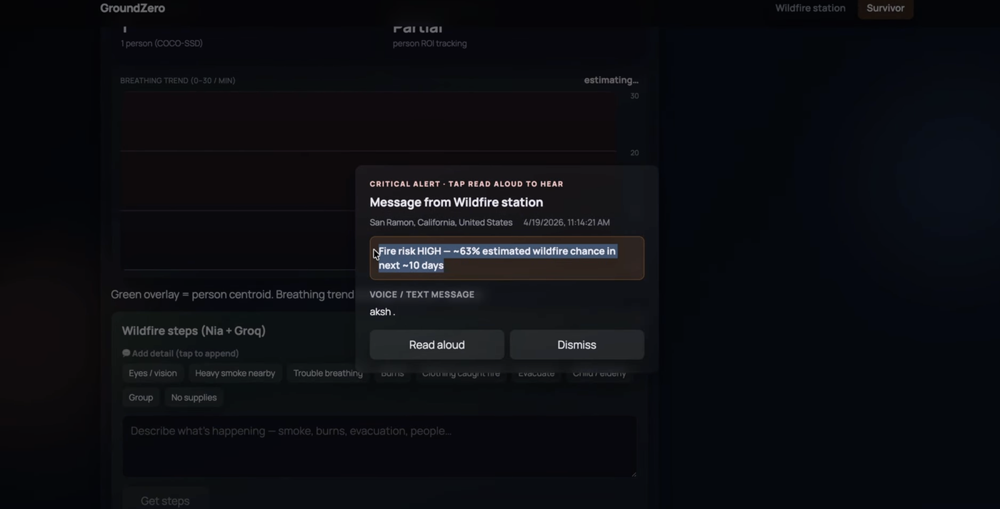
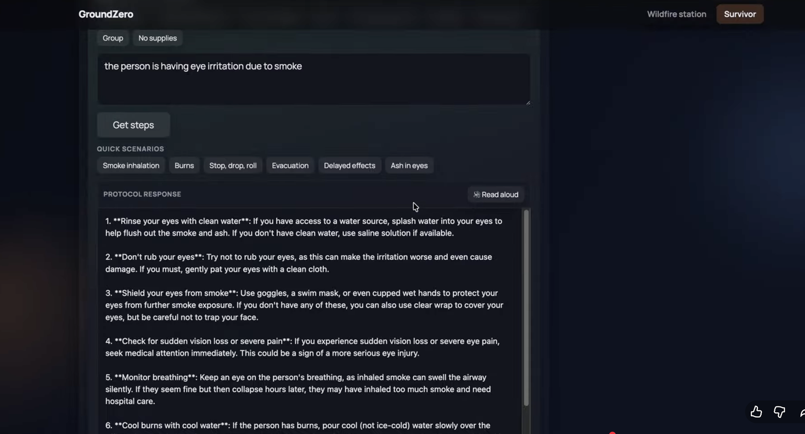
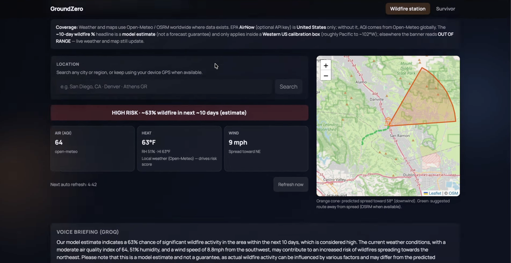
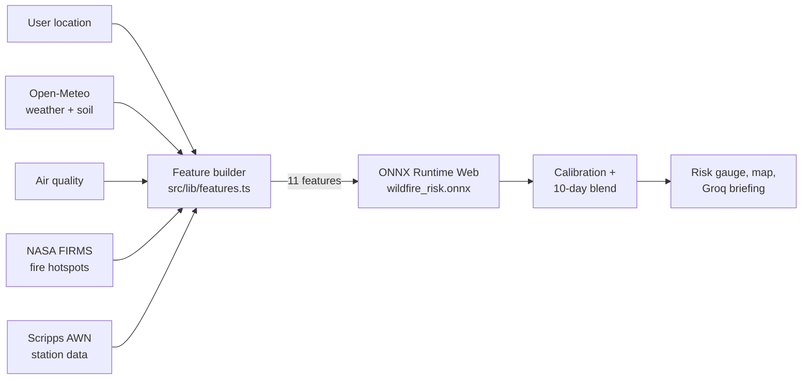

# GroundZero: Wildfire Risk Intelligence and Survivor Support in the Browser

**GroundZero predicts local wildfire risk with an XGBoost model that runs entirely in the browser through ONNX Runtime Web, and pairs it with on-device computer vision tools that help survivors and responders during a fire.**

<p>
  <a href="https://youtu.be/Hkthc73Oz1o"></a>
  
  
  
  
  
  
</p>

**Demo video:** https://youtu.be/Hkthc73Oz1o
<!-- TODO: add once deployed to Vercel
**Live demo:** https://YOUR-APP.vercel.app
-->

<p align="center">
  
</p>
<p align="center"><em>Wildfire Station: in-browser risk estimate, live conditions, downwind spread cone, and a suggested route away from the fire.</em></p>

<table>
  <tr>
    <td width="50%"></td>
    <td width="50%"></td>
  </tr>
  <tr>
    <td align="center"><em>On-device person detection, pose tracking, and one-tap distress call</em></td>
    <td align="center"><em>Station broadcasts arrive as critical alerts that can be read aloud</em></td>
  </tr>
  <tr>
    <td width="50%"></td>
    <td width="50%"></td>
  </tr>
  <tr>
    <td align="center"><em>Step-by-step wildfire protocol from a plain-language description</em></td>
    <td align="center"><em>Groq voice briefing explaining the risk drivers</em></td>
  </tr>
</table>

---

## The Problem

Wildfire alerts usually arrive as regional warnings. People in the path of a fire need a risk read for **where they are standing right now**, and survivors need guidance that still works when the network is unreliable. GroundZero runs the risk model and the vision models **on the client**, so there is no inference server to scale, no per-request cost, and no user location or camera data sent to a backend for prediction.

## Key Features

### Wildfire Station
- **In-browser ML risk score:** an XGBoost regressor exported to ONNX scores 11 live environmental features in the browser, with calibration and a 10-day probability blend.
- **Any location:** uses device GPS or a searched city. The risk estimate is calibrated for the Western US and shows OUT OF RANGE elsewhere, while weather and maps keep working worldwide.
- **Live data fusion:** combines Open-Meteo weather and soil moisture, air quality, NASA FIRMS fire hotspots, and Scripps AWN station readings, refreshing automatically every few minutes.
- **Spread and evacuation map:** Leaflet map with a downwind spread cone based on live wind direction and an OSRM route that leads away from it.
- **AI voice briefings:** Groq LLM summaries that explain the risk drivers in plain language and can be read aloud.

### Survivor
- **Person detection:** TensorFlow.js COCO-SSD counts people in the webcam feed, entirely on device.
- **Vitals-style cues:** MoveNet pose and face mesh tracking drive a chest-motion breathing trend and camera-based pulse (rPPG) estimate.
- **One-tap distress call:** sends the latest scanned people count straight to the Wildfire Station.
- **Protocol guidance:** describe the situation or tap a quick scenario (smoke inhalation, burns, evacuation, ash in eyes) for step-by-step wildfire steps from Nia retrieval and Groq.
- **Voice and audio:** speech input, read-aloud alerts and protocols, and a smoke alarm tone listener.
- **Two-way alerts:** station broadcasts and survivor distress calls move between open dashboards over the BroadcastChannel API.

## How It Works



### The Model

| | |
|---|---|
| **Algorithm** | XGBoost regressor (120 trees, max depth 6, learning rate 0.06) |
| **Training data** | 437 samples from NOAA NCEI Storm Events, CAL FIRE / NIFC perimeters, Open-Meteo historical weather and air quality, and Scripps AWN |
| **Features (11)** | temperature, humidity, heat index, wind speed, wind direction, AQI, vegetation dryness, soil moisture, hour, month, distance to nearest recent fire |
| **Export** | `onnxmltools` to ONNX (opset 12), served from `public/models/` |
| **Inference** | ONNX Runtime Web, fully client side |

The training pipeline lives in `scripts/` and can be re-run with one command (see below). Feature order is shared between `scripts/export_onnx.py` and `src/lib/features.ts`, and `scripts/verify_onnx_risk.py` checks the exported model.

## Tech Stack

| Layer | Tools |
|---|---|
| Frontend | React 19, TypeScript, Vite 6 |
| Machine learning | XGBoost, ONNX, ONNX Runtime Web, Python |
| Computer vision | TensorFlow.js, COCO-SSD, MoveNet, face mesh |
| Maps and routing | Leaflet, OpenStreetMap, OSRM |
| Data sources | Open-Meteo, NASA FIRMS, NOAA, CAL FIRE, Scripps AWN, EPA AirNow (optional) |
| LLM | Groq API (OpenAI compatible), Nia (optional) |

## Getting Started

**Prerequisites:** Node.js 18+. Python 3 only if you retrain the model.

```bash
git clone https://github.com/aksh-m07/Ground_Zero_Data_Hacks.git
cd Ground_Zero_Data_Hacks
npm install
npm run dev
```

Open the URL Vite prints (usually `http://localhost:5173`) and use the header to switch between **Wildfire Station** and **Survivor**. Camera, microphone, and location permissions are needed for the Survivor tools.

### Environment Variables

Create a `.env` file in the project root:

| Variable | Required | Purpose |
|---|---|---|
| `VITE_GROQ_API_KEY` | Recommended | Wildfire briefings and survivor protocol generation |
| `VITE_NIA_API_KEY` | Optional | Nia retrieval before Groq in the protocol panel |
| `VITE_SCRIPPS_CSV_URL` | Optional | Scripps AWN CSV source (defaults to `public/scripps/`) |
| `VITE_PULSE_BRIDGE_URL` | Optional | URL of the local pulse bridge server |

The risk model, maps, and vision tools work without any keys. Never commit `.env`.

### Scripts

| Command | Description |
|---|---|
| `npm run dev` | Start the Vite dev server |
| `npm run build` | Production build to `dist/` |
| `npm run preview` | Serve the production build locally |
| `npm run export-model` | Rebuild the dataset, retrain XGBoost, and export ONNX to `public/models/` |
| `npm run pulse-bridge` | Optional Node server for pulse sessions over SSE |

## Project Structure

```
src/
  components/   Dashboards, risk gauge, spread map, smoke listener, alert UI
  hooks/        Wildfire risk, geolocation, webcam, person detection, rPPG, breathing, speech
  lib/          Feature builder, ONNX inference, calibration, data clients, Groq, routing
docs/           README screenshots
public/
  models/       wildfire_risk.onnx, feature importances, training metadata
  scripps/      Scripps AWN station data
scripts/        Data collection, training, ONNX export and verification (Python)
server/         Optional pulse bridge server (Node)
```

## Limitations and Next Steps

- The model is trained on 437 samples, so scores are an indicator, not an official forecast. Expanding the dataset and adding a held-out evaluation are the next priorities.
- Camera-based vitals are rough cues, not medical measurements.
- Planned: hosted live demo, offline support for the Survivor view, and model metrics (precision and recall on a test split) published in this README.

> **Safety note:** GroundZero is a research and hackathon project. Always follow official evacuation orders from local authorities and CAL FIRE.

## Team

Built at DataHacks 2026. Model training, ONNX export, and in-browser inference by [Aksh Malik](https://github.com/aksh-m07).
<!-- TODO: add teammates' names and GitHub links -->

## License

<!-- TODO: add a LICENSE file (MIT is common) and update this line -->
All rights reserved by the authors unless a license file is added.
EOF
head -1 README.md
ls docs
git add README.md
git commit -m "Restore GroundZero README with cleaner badges"
git push
